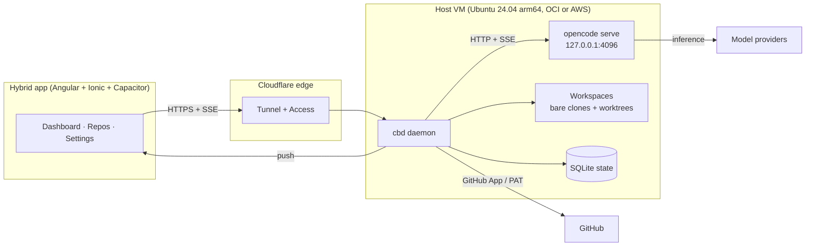

# Codebox

**Command your coding agents from anywhere.**

Codebox is a private control plane for [OpenCode](https://opencode.ai) running on your
own cloud VM. A hybrid Angular app — iOS, Android and web — is the ground station: you open
a repository, its backlog is the list **and** the queue, and tapping an item starts a **work**
bound to that repository. The repository's schedule consumes the backlog in file order; a chat
is an editor for the backlog, the design or one work's decisions. Every run gets its own
worktree and branch, and a green run merges itself.

> **Status: bootstrapped (2026-10-26).** The npm workspace skeleton, the root gate and CI are in
> place, and the tree holds the daemon, the app, the agent pipeline, one provider-neutral
> Ubuntu 24.04 arm64 image and both Terraform stacks (`infra/oci`, `infra/aws`). The OCI A1
> capacity wait is still open; the AWS spot host runs the same image until it lands. The
> decisions in [`docs/decisions.md`](docs/decisions.md) are the contract; everything else
> follows them.

## Why

Running `opencode` on a laptop stops when the lid closes. Running it on a VM gives it a
stable home, warm caches and a public network identity, but then the only interface is SSH
from a desk. Codebox closes that gap:

- **The app is the terminal.** A native-feeling hybrid app, not a web console in a browser
  tab, with push notifications when a run finishes or needs a decision.
- **The backlog is the product.** `TODO.md` in the repository is the list: in the file's order,
  with each item's runtime state overlaid. An item is already a prompt — title, body and
  acceptance criteria — and its tick rides in the work's PR. No second list to drift (D51).
- **One unit: the work.** One backlog item, one repository, as many runs as attempts. The
  repository is the root; there is no free chat and no handoff (D44, D53).
- **A chat is an editor.** It edits the backlog, the design or one work's decision, and the
  target is its write boundary; it proposes, the merge disposes (D55).
- **The schedule belongs to the repository.** A window consumes the backlog in file order, so
  the file's order is the priority (D56).
- **Autonomy with a leash.** Runs open a PR, run the repo's gate, and merge only when every
  guardrail passes. One switch parks the whole thing.
- **One box, no inbound ports.** The daemon and OpenCode live on the VM; a tunnel exposes
  only the daemon's HTTPS endpoint, and the app pairs with it like a device.

## The shape

## What it is not

- **Not a messaging bot.** The hybrid app is the only client in v1; there is no chat-network
  integration to maintain, police or keep online.
- **Not a SaaS.** One operator, one VM, one installation. No signup, no tenants, no billing.
- **Not an editor.** The app reviews diffs and steers work; it does not replace the IDE.
- **Not a general CI.** It runs a repo's own gate before merging, but GitHub Actions remains
  the CI of record when a repository has it.

## Documentation

| Doc | What it answers |
| --- | --- |
| [`docs/product.md`](docs/product.md) | Who it is for, the flows, MVP scope and non-goals. |
| [`docs/architecture.md`](docs/architecture.md) | Components, data flow, repo layout, failure modes. |
| [`docs/app.md`](docs/app.md) | The hybrid Angular app: stack, screens, templates, offline, push. |
| [`docs/api.md`](docs/api.md) | The versioned HTTP + SSE contract between app and daemon. |
| [`docs/agent-runtime.md`](docs/agent-runtime.md) | How Codebox drives OpenCode V2, sessions, permissions, workspaces. |
| [`docs/jobs.md`](docs/jobs.md) | Scheduling, run lifecycle, gate, PR and auto-merge guardrails. |
| [`docs/providers.md`](docs/providers.md) | Every `CB_*` environment variable, providers and secret handling. |
| [`docs/security.md`](docs/security.md) | Threat model, pairing, tokens, tunnel, sandbox, prompt injection. |
| [`docs/oci.md`](docs/oci.md) | The extracted OCI resources and the renamed retry action. |
| [`docs/aws.md`](docs/aws.md) | The AWS spot stack: inventory, image, single door, backups, cost. |
| [`docs/vm-image.md`](docs/vm-image.md) | Building and updating the VM image. |
| [`docs/operations.md`](docs/operations.md) | Install, upgrade, backup, brake, recovery, costs. |
| [`docs/agent-pipeline.md`](docs/agent-pipeline.md) | The multi-agent batch workflow used to build this repo. |
| [`docs/agent-spec-template.md`](docs/agent-spec-template.md) | The per-task spec format the Architect writes. |
| [`docs/agent-ci.md`](docs/agent-ci.md) | The GitHub Actions host of the autopilot. |
| [`docs/agent-vm.md`](docs/agent-vm.md) | The VM host of the autopilot. |
| [`docs/decisions.md`](docs/decisions.md) | The `D##` decisions, frozen. |
| [`docs/roadmap.md`](docs/roadmap.md) | Phases, batches and exit criteria. |
| [`docs/open-questions.md`](docs/open-questions.md) | What still needs a human answer. |
| [`TODO.md`](TODO.md) | The execution backlog, cut into batches. |

## Decisions at a glance

| | |
| --- | --- |
| Name | **Codebox**; binary `codebox`, short alias `cb`. |
| Client | Hybrid Angular 22 + Ionic Angular 9 + Capacitor. |
| Agent runtime | OpenCode V2 server on loopback; one session per run. |
| Runtime | Node 24 LTS + TypeScript, one `cbd` daemon under systemd. |
| State | SQLite in WAL mode under `/var/lib/codebox`. |
| Exposure | Cloudflare Tunnel only; no inbound ports except admin SSH. |
| Git | GitHub App first, fine-grained PAT as fallback. |
| Autonomy | Branch + PR + gate, then **auto-merge when every guardrail is green**. |
| Host | One provider-neutral Ubuntu 24.04 arm64 image; the OCI Always Free Ampere box first, an AWS spot box meanwhile (D42). |
| Providers | The daemon is configured through `CB_*` env vars, validated at boot. |

## Name

A codebox is the box where the code and the agents that work on it live: it stays on your
own VM, you open it from anywhere, and you decide what may leave it. The name is literal on
purpose — no mission-control metaphor, and nothing a cloud provider already owns. The short
binary is `cb`; `codebox` is the canonical name in docs, packages and systemd units.

Alternatives considered: *Groundstation* (collides with AWS Ground Station), *Pilotbox*,
*Codecrate*, *Codehaven* (kept as fallbacks), *Deckhand*, *Patchbay* and *Interlock* (already
used by agent tooling in 2026).

## Next

The tree is bootstrapped (the status above is the state of `main`): the daemon, the app, the
agent pipeline, the image and both Terraform stacks are merged. The open work is the OCI A1
capacity wait and the batches after it, tracked in [`TODO.md`](TODO.md).
