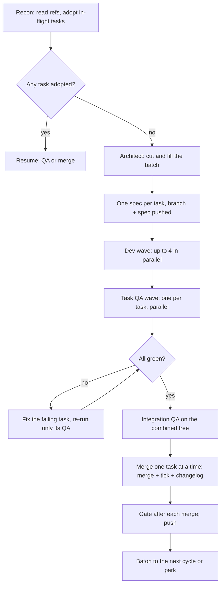

# The agent pipeline

Codebox builds itself with the same contract it gives its users: a batch of tasks, each on its
own branch, each verified by someone who did not write it, merged only when the gate is green.
This document is the protocol. `docs/agent-ci.md` and `docs/agent-vm.md` are its two hosts;
they implement the same rules and cannot drift.

The pipeline is **not** the product. The product is `cbd`, the daemon in `apps/daemon`, run by
systemd as user `codebox`. The pipeline is a development harness that runs `opencode run`
headless as the operator, in `~/cb-agent`, and never touches `/var/lib/codebox`. A task that
confuses the two is a bug.

## 1. Roles

| Role | Writes | Never |
| --- | --- | --- |
| **Orchestrator** (primary) | `TODO.md` ticks, merge commits, `CHANGELOG.md` | Writes feature code; approves its own work. |
| **Architect** | `TODO.md` plan, `.agent_specs/task-<ID>.md` | Touches application code or configuration. |
| **Dev** (one per task) | Its exclusive paths in its worktree | Leaves its worktree; merges. |
| **QA** (one per task + one integration) | `[PENDING FIXES]` in its own worktree | Fixes the defect; validates its own work. |

The human talks only to the Orchestrator. Every role starts from a fresh context and receives
**only** `AGENTS.md` plus a spec path — never the parent conversation.

The prompts live in `.agent_roles/`. They are part of the design and are reconciled with the
scripts in Batch 1; if a prompt and this document disagree, this document wins and the prompt
is fixed.

## 2. Batches

A batch is an **antichain**: no task depends on a file another task in the same batch
produces, and no two tasks create or modify the same path. Exceptions, named in the plan:

- a `docs/*.md` file split into disjoint sections, one owner each;
- a hot file, held by exactly one task.

**Hot files in this repository:** `package.json`, `package-lock.json`, `tsconfig.base.json`,
`apps/app/angular.json`, `apps/app/src/app/app.routes.ts`, `apps/app/src/main.ts`,
`apps/daemon/src/main.ts`, `packages/contracts/src/index.ts`, `opencode.json`, `TODO.md`,
`CHANGELOG.md`, `docs/decisions.md`, and any generated API file.

**Filling.** A batch that would run one task must try to pull dependency-free tasks from later
batches when their paths are disjoint and their dependencies are merged. Four dev slots is the
target; a one-task batch is a last resort, and every empty slot is recorded with the constraint
that blocked it. The **effective** slot count is host-bound: `CB_AGENT_MAX_DEVS` is 2 on the
2 OCPU runner and the 2/12 box, and may rise to 4 on a 4/24 box. A host with fewer cores is a
reason to set the number, never a licence to serialise.

**Specs for one batch only.** Later batches are re-planned with what actually shipped; a spec
for unattempted work rots.

## 3. Worktrees and specs

```bash
git worktree add ../wt-cb-<ID> -b task-<ID>
```

One worktree per task, outside the repository, named `wt-cb-` (never `wt-pkm-`, never
`wt-task-`). The Architect writes `.agent_specs/task-<ID>.md`; the Orchestrator **copies** it
into the worktree (never a symlink), commits it with `git add -f` as `spec: task-<ID>` and
pushes the branch. The spec travels in the branch and is dropped from the merge, so `main`
never receives it.

A subagent receives its spec path and `AGENTS.md`, nothing else. The spec must be executable
by someone who has read nothing else (`docs/agent-spec-template.md`).

## 4. One cycle



1. **Recon.** `scripts/agent/recon.mjs` fetches, lists live `task-*` branches, checks which are
   already in `main`, reads each tip's subject and spec, and writes `.agent_specs/resume.md`.
   It is pure where it can be and unit-tested; the state a cycle acts on is a function of the
   refs, not of a model's memory.
2. **Adopt.** A live branch is a task in flight: `dev: done` → QA; `qa: pass` → merge;
   `partial` → delete and redo; `blocked`/`merged` → clean up. Never cut a new batch while a
   live branch remains.
3. **Plan.** The Architect cuts the lowest pending batch, fills the empty slots, records the
   plan in `TODO.md`, and stops on a genuine open question instead of guessing.
4. **Spec.** One spec per task, exactly the template.
5. **Dev wave.** One dev subagent per task, all launched together, each in its own worktree.
   The Orchestrator **waits** for every one: a background subagent dies with the runner.
6. **QA wave 1.** One QA per task, launched together, each from its own integration worktree
   (that task's branch merged onto the batch base). It runs that task's plan verbatim and
   audits that task's diff.
7. **QA wave 2.** One short integration pass on the combined tree: batch gates, cross-task
   audit, merge rehearsal. A batch of exactly one task collapses both waves into one pass,
   because the per-task tree *is* the combined tree.
8. **Ship.** One task at a time, in ID order: merge `--no-ff`, drop the spec, tick `TODO.md`,
   append `CHANGELOG.md`, run the full gate, push, delete the branch and the worktree.

A cycle that moves nothing is **red**: it must leave a merge, a `[!]` block or an issue.

## 5. The durable unit is the task

A runner is ephemeral and a model stream is not reliable. The batch does not survive; the task
does. The state is two refs and one convention:

| Ref | Means |
| --- | --- |
| `origin/main` | shipped, with each task's tick and changelog entry |
| `origin/task-<ID>` | a task in flight, its spec as the first commit |
| the branch tip's subject | whose turn it is |

- `dev: done task-<ID>` — the dev finished and its own gate was green; QA is next.
- `qa: pass task-<ID>` — QA validated that exact tip; the merge is next.
- anything else — the dev died. The branch is **deleted and redone**, never resumed: trusting
  half a task costs more than paying for it again.

A QA verdict is a commit, not a message: an empty commit whose body carries `Verified-At`,
`Tip`, `Gates` and `Report`. A later commit moves the tip and the verdict stops applying.

## 6. One push per task

The merge, the `TODO.md` tick and the `CHANGELOG.md` entry are one commit and one push. `main`
is therefore consistent at every boundary: no cycle leaves code shipped but unticked, or a
tick without the code. The merge is `--no-ff`, one task at a time, with the gate green after
each merge.

## 7. Gates

| Gate | Command | When |
| --- | --- | --- |
| Task gate | the commands in the spec | Before `dev: done`. |
| Task QA | the spec's plan, verbatim | Once per task. |
| Batch gate | `npm ci && npm run lint && npm test && npm run build` | On the combined tree. |
| Merge gate | the same, after each merge | Before the push. |
| E2E | `npx playwright test` when the spec says so | Task or batch. |

A criterion is tagged `[unit]` (a command, a decoded value, a pinned number) or `[live]` (only
measurable in the running system). An untagged criterion is a spec bug. A `[live]` criterion
states its measurement.

## 8. The brake and the verdict

- The loop is **off** until a human arms it. On Actions the brake is the repository variable
  `CB_AGENT_AUTOPILOT=on`; on the VM it is `$CB_AGENT_STATE/brake`. It takes effect at a cycle
  boundary, so a merge is never cut in half.
- The **verdict** is the job's outcome, not the agent's exit code: a red gate fails; a moved
  `main` or an opened issue passes even when the stream died; nothing moved and no issue is a
  failure.
- A transport drop that shipped nothing is retried **once** inside the job, after a fresh
  Recon. A drop that already shipped is not retried; the next cycle resumes.
- Three red cycles in a day park the loop until a human looks. `CB_AGENT_DAILY_CYCLES` caps a
  normal day when set; unset or `0` means no cap.
- A **timed window** (`CB_AGENT_FROM`/`CB_AGENT_UNTIL`, absolute UTC) is a belt under the
  brake: a stale `on` cannot start a cycle past its end.

## 9. No human inside a cycle

- Never use the `question` tool in an unattended run: it hangs the job. A real block becomes
  an `agent-blocked` issue with the literal error and the decision needed. An issue whose body
  is a placeholder is a failure, not a block.
- A blocking open question from the Architect stops the cycle **before** any worktree is cut
  and produces that issue.
- A `*Decision:*` line on a backlog item is the human's answer, frozen. Its absence means the
  audit found no decision was needed; it is not a block.

## 10. What changed from `pkm-randomlike`

| Donor | Codebox |
| --- | --- |
| `wt-pkm-`, `pkm-agent`, `PKM_*` | `wt-cb-`, `cb-agent`, `CB_AGENT_*` |
| Phaser/asset store rules | npm workspaces, Angular, daemon and packages |
| `npm test && npm run build` | `npm ci && npm run lint && npm test && npm run build` |
| Browser evidence via the game canvas | Playwright against the daemon and the built app |
| `prompt.md` shaped for a game | A prompt shaped for a private control plane |
| No product/runtime split | The pipeline and `cbd` are separate users, directories and ports |

The protocol, the markers, the two QA waves, the brake and the verdict are unchanged: they
were measured, not invented.

## 11. Failure modes

| Failure | Response |
| --- | --- |
| Dev dies mid-task | Branch deleted, task redone. |
| QA finds a red criterion | Fix in the task's worktree, re-run **that** QA only. |
| Two tasks touched one path | Integration QA is red; the batch does not merge. |
| Merge conflict with `main` | Fetch and merge `origin/main` into the task branch, re-run QA. |
| `main` moved during the final push | Fetch, re-merge, re-gate, push. |
| Runner dies after a merge | The next cycle's Recon sees `main` moved; nothing is lost. |
| Agent launches work in the background | The verdict sees nothing moved and fails the cycle. |
| Spec is wrong or incomplete | QA reports it as a spec bug; the Architect fixes the spec, not the code. |

## 12. Escalation

A cycle escalates by opening one issue labelled `agent-blocked` with: the task id, the exact
command and error, the decision needed, and the options. It then parks. A human answer is
written into `TODO.md` as `*Decision:*` and the loop is re-armed. Silence is a parked loop,
never a guessed decision.
