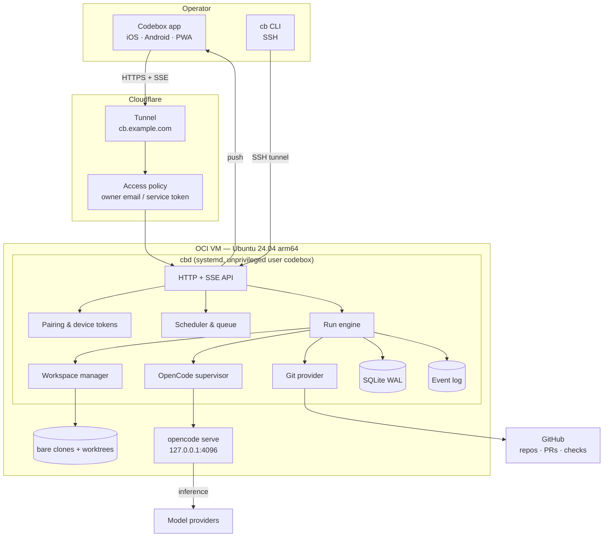
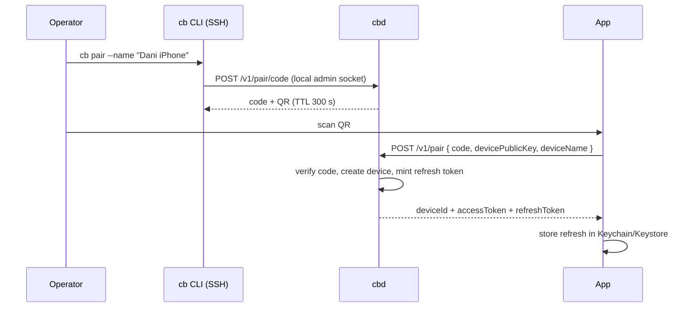
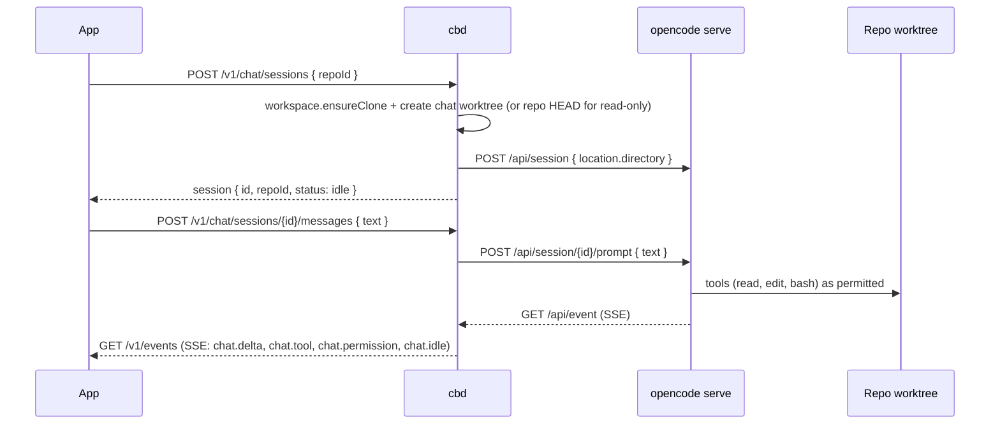
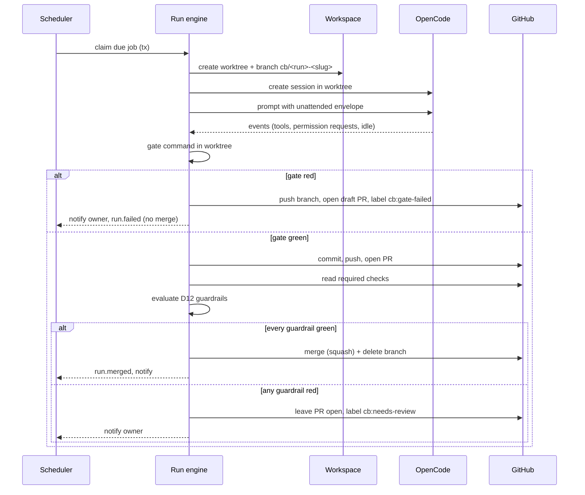
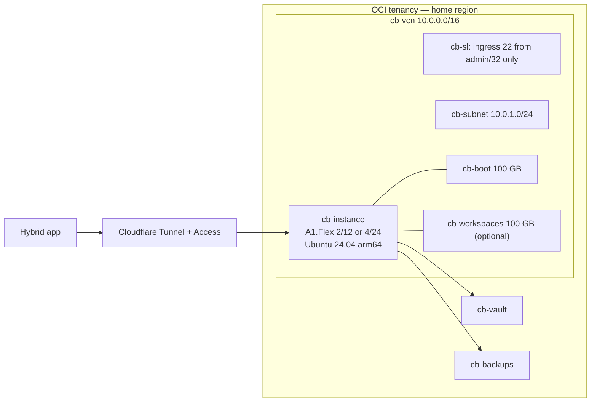

# Architecture

Codebox is one small daemon on one VM, one OpenCode server behind it, and one app that
speaks a versioned HTTP + SSE contract. Everything else is a consequence of keeping that
sentence true.

## 1. Context



Trust boundaries:

1. **Cloudflare → daemon.** Cloudflare terminates TLS and applies Access. The daemon still
   authenticates every request with its own device token (D17); Access is defence in depth,
   never the only gate.
2. **Daemon → OpenCode.** Loopback only. OpenCode has no public listener and no credential
   of its own beyond the model provider keys the daemon starts it with.
3. **Daemon → repository.** The worktree is untrusted content: `AGENTS.md`, code, fixtures
   and issue text can try to steer the agent. The run envelope and the permission policy
   (D27) are the boundary, not the repository's cooperation.
4. **Daemon → GitHub.** An installation token scoped to the selected repositories; the
   daemon never holds an organisation-wide credential.

## 2. Components

### `apps/daemon` — `cbd`

The only long-running process. Responsibilities:

- **HTTP + SSE API** (`/v1`), static hosting of the built Angular app, pairing endpoints.
- **Auth**: pairing codes, device registry, access/refresh tokens, revocation, scopes.
- **Scheduler**: cron evaluation, due-job claiming, queue order, misfire policy.
- **Run engine**: the state machine (`queued → … → succeeded`), gate execution, PR creation,
  auto-merge decision, cancellation, timeouts, cost guard.
- **Workspace manager**: bare clone cache, fetch, worktree create/remove, disk cleanup.
- **OpenCode supervisor**: starts `opencode serve`, health-checks it, restarts it, maps
  sessions to chats/runs, normalises events, bridges permissions.
- **Git provider**: GitHub App authentication, branch push, PR open/merge, check status.
- **Store and event log**: SQLite for state; append-only events for replay and audit.
- **Notifications**: Web Push and Capacitor push, one payload per event type.
- **`cb` CLI**: a thin client over the same API for bootstrapping, pairing, diagnostics and
  emergency operations over SSH.

The daemon is deliberately a modular monolith. Packages expose pure functions and ports;
only the daemon does I/O. A package that needs the network receives a client, never a global.

### `apps/app` — hybrid client

Angular 22 + Ionic Angular 9 + Capacitor (D4). Screens, state and offline behaviour are in
[`app.md`](app.md). The app never talks to OpenCode, GitHub or the model providers
directly; it talks to `/v1` and renders events.

### `packages/contracts`

The single source of truth for every boundary: zod schemas for HTTP bodies, SSE events,
OpenCode events and config. The app imports the types; the daemon parses with the schemas;
`docs/api.md` is generated from (or checked against) them. A contract change is a batch, not
a drive-by edit.

### `packages/core`

Pure domain logic:

- run state machine and transition guards;
- auto-merge policy (the D12 list, as a function of facts);
- cron/misfire policy (D13);
- protected-path and diff-budget checks (D26);
- cost and timeout guards (D29);
- permission policy for unattended agents (D27).

Every function here is deterministic and unit-tested. It does no I/O and knows no HTTP.

### `packages/store`

SQLite schema, numbered migrations, repositories. One connection in the daemon; WAL; a
single writer. Migrations are forward-only SQL files pinned by checksum: `0001_init.sql`
creates the ten v1 tables below, and the routines tables arrive in `0002` (Task-34). Tables:

| Table | Purpose | Migration |
| --- | --- | --- |
| `repos` | Registered repositories and per-repo policy. | `0001_init.sql` |
| `jobs` | Reusable job definitions, cron, timezone, prompt, mode. | `0001_init.sql` |
| `runs` | One execution: trigger, state, branch, worktree, session, PR, gate, cost. | `0001_init.sql` |
| `routines` | Chat schedules: `prompt` or `reminder`, cron, IANA timezone, optional chat session. | `0002_routines.sql` (Task-34, planned) |
| `routine_fires` | One row per fire; `(routine_id, scheduled_for)` is the idempotency key. | `0002_routines.sql` (Task-34, planned) |
| `run_events` | Append-only timeline (`seq`, `type`, `payload`, `ts`). | `0001_init.sql` |
| `approvals` | Permission requests and their replies. | `0001_init.sql` |
| `chat_sessions` | Persistent chat sessions bound to a repo. | `0001_init.sql` |
| `chat_messages` | User/assistant/tool messages with retention. | `0001_init.sql` |
| `devices` | Paired devices, public keys, token hashes, scopes, revocation. | `0001_init.sql` |
| `settings` | Non-secret key/value settings and schema version. | `0001_init.sql` |
| `usage` | Token/cost ledger per run and per day. | `0001_init.sql` |

### `packages/opencode`

A pinned `@opencode/client` wrapper plus a normaliser:

- `createSession({ directory, agent?, model? })`
- `prompt(sessionId, text, { signal })`
- `subscribe(sessionId | all)` → normalised events
- `interrupt(sessionId)`
- `replyPermission(sessionId, requestId, reply)`
- `listModels()`, `listAgents()`
- health and version probes

The wrapper is the only place that knows OpenCode's payload shapes. If OpenCode changes a
field, one package and its fixtures change. See [`agent-runtime.md`](agent-runtime.md).

### `packages/workspaces`

- `ensureClone(repo)` → bare clone under `repos/<owner>__<name>.git`, cloned into a temporary
  directory and renamed into place, then fetched with `--prune`; a failed clone leaves no half
  directory and never creates the cache entry.
- `createWorktree(repo, runId, baseRef)` → `/srv/codebox/worktrees/<runId>`, branch
  `cb/<runId>-<slug>`, and the run marker written at the path git reports for
  `codebox-run.json` — a linked worktree's `.git` is a file, so the marker lives in the real
  git directory, not at `<worktree>/.git/codebox-run.json`.
- `removeWorktree(worktree)` → `git worktree remove --force`, then prune.
- `status(worktree)` → changed files, diff stat, protected-path hits; the base is the commit the
  branch was cut from, never re-resolved, because G4 compares it with the base tip.
- `cleanup()` → remove worktrees past retention; keep the cache.

I/O lives in this package: `node:fs` for the cache and worktree directories plus
`node:child_process` for git (§5's line predates it and omits `node:fs`). Every git call goes
through the injected `GitRunner`, so the package is provable headless with a fake runner and
with real local repositories in its tests. The clock, retention TTL and the D26 glob matcher
are arguments, never globals; the `CB_*` values arrive from the daemon. Errors carry a code, the
git subcommand and the exit code — never git's `stderr`, an argument list or a clone URL,
because the URL carries the installation token.

Rules: never symlink an external tree into a worktree; never reuse a worktree across runs;
never touch the operator's own clone or a directory this package did not create.

### `packages/scheduler`

Cron parsing (`croner` or equivalent), next-run calculation in an IANA timezone, due
selection with a grace window, and a pure `nextState(job, now, lastRun)` function. The daemon
polls every 15–30 seconds; the queue is the `runs` table, not memory.

### `packages/git-provider`

A port:

```ts
interface GitProvider {
  verifyRepo(slug: string): Promise<RepoInfo>;
  pushBranch(repo: RepoInfo, worktree: string, branch: string): Promise<void>;
  openPullRequest(input: OpenPrInput): Promise<PullRequest>;
  getChecks(pr: PullRequest): Promise<CheckSummary>;
  mergePullRequest(pr: PullRequest, method: MergeMethod): Promise<MergeResult>;
  closePullRequest(pr: PullRequest): Promise<void>;
}
```

GitHub is the first implementation (App token or PAT). GitLab is a later adapter; nothing in
`core` may import the GitHub client.

### `packages/security`

- pairing code generation and verification (constant-time, single use, TTL);
- device key fingerprints and token hashing (Argon2id or scrypt);
- access/refresh token minting and scope checks;
- redaction (key allowlist/denylist) for logs and error payloads;
- Cloudflare Access JWT verification (optional outer layer);
- webhook signature verification (GitHub, if webhooks are enabled).

## 3. Flows

### 3.1 Pairing a device



The pairing code is single-use and expires (D17). `cb pair` is only reachable over SSH or a
loopback admin socket, never through the tunnel without an existing device token.

### 3.2 Chat



A chat session persists (D36), so the agent keeps context across messages. Chat is not a run:
it does not open a PR and it never merges. If the operator wants the chat's work shipped,
they promote it (`POST /v1/chat/sessions/{id}/promote`): a run adopts the same worktree, cuts
a `cb/` branch and continues through the normal gate and guardrails.

### 3.3 Scheduled job → PR → auto-merge



The gate runs **before** the PR opens, so a red run never presents as mergeable. The PR then
carries the evidence: prompt, agent/model, diff stat, gate output tail, run link.

### 3.4 Permission request

OpenCode can ask before a tool runs. The daemon:

1. normalises the request into an `approval` row (`pending`, TTL 10 minutes);
2. emits `run.permission` / `chat.permission` with a short human summary and the exact tool;
3. pushes to the app (unless the run's policy already allows the tool);
4. on reply, calls OpenCode's permission reply endpoint and emits `approval.resolved`;
5. on expiry, replies `reject` and marks the approval `expired`.

Unattended runs use a policy, not a human: edits and in-worktree bash are allowed; `webfetch`
is denied; anything outside the workspace is rejected (D27). A policy denial is logged as an
event, not raised as a notification storm.

## 4. Deployment topology



- **No inbound port** except 22 from the admin address (D18). Cloudflare Tunnel is an
  outbound connection from `cloudflared`.
- **Two disks**: boot (image + app + state) and an optional block volume for worktrees. If
  only the 100 GB boot volume exists, worktrees live under `/srv` on it and retention is
  tighter.
- **systemd units**: `codebox.service` (daemon), `codebox-opencode.service`
  (supervised agent server), `cloudflared.service` (tunnel). OpenCode may also be started by
  the daemon as a child; the unit exists for crash isolation and restart policy. D5 keeps it
  on loopback either way.
- **No database server, no Redis, no container runtime required.** A container sandbox for
  jobs is optional hardening, not a v1 dependency.

## 5. Repository layout and package boundaries

```
apps/daemon        → may import every package; owns all I/O and process lifecycle
apps/app           → imports contracts only; never a daemon package
packages/contracts → no imports outside zod
packages/core      → contracts only; pure; no node:fs, no fetch
packages/store     → contracts + node:sqlite
packages/opencode  → contracts + @opencode/client
packages/workspaces→ contracts + node:child_process (git)
packages/scheduler → contracts + core + cron library
packages/git-provider → contracts + fetch
packages/security  → contracts + node:crypto
```

Rules enforced by review and, later, by a dependency-cruiser check:

- `core` never imports a provider, a store or the daemon.
- The app never imports `@opencode/client`, Octokit or an inference SDK.
- Only `packages/opencode` knows OpenCode's wire shapes.
- Only `packages/git-provider` knows GitHub's wire shapes.
- Every boundary parses with a contract schema.

## 6. Failure modes

| Failure | Behaviour |
| --- | --- |
| OpenCode server crashes | Supervisor restarts it; in-flight runs fail with `agent_unavailable` and keep their branch/worktree for inspection. Chat shows a reconnecting state. |
| Model stream drops | The run is marked `failed` only if nothing was produced; a retry is a new run, never a silent resume of a half task. |
| GitHub is down | The run finishes locally, pushes when possible, and parks in `pr_open` with `github_unavailable`; retry is idempotent by branch name. |
| Tunnel is down | The app cannot reach the daemon; runs continue. On reconnect, SSE replays from `Last-Event-ID` within retention. |
| VM reboots | systemd starts the units; boot reconciliation marks orphaned `running` runs as `failed` with `instance_restarted`, removes stale locks, and resumes the queue. |
| Disk full | The run engine refuses new runs, cleans old worktrees, raises `telemetry` with `disk_low`; the app shows a blocking banner. |
| Clock/DST | Cron uses IANA zones and the misfire policy (D13); a missed fire is explicit, never a silent catch-up storm. |
| Routine's chat session archived or absent | A `prompt` routine creates a new chat session for the fire; it never appends to an unrelated session. |
| Token expired/revoked | GitHub App tokens refresh; a revoked device gets `401` and must re-pair; the app clears its local token. |
| Cost cap reached | The current run is cancelled, the queue pauses, the owner is notified; the next UTC day resets it. |
| Duplicate scheduler tick | Claiming a run is a SQLite transaction with a unique `(job_id, scheduled_for)` constraint; a second tick updates nothing. |

## 7. What we deliberately did not build

- **A message-queue service.** SQLite plus one daemon is enough for two concurrent runs. A
  queue is a later decision if the measured queue depth or latency demands it.
- **Multi-tenancy.** It would force per-tenant keys, quotas, isolation and a billing model for
  a product with one user.
- **A plugin system for channels.** The app is the channel. The `Channel` abstraction exists
  in the API, not as a loader.
- **Remote code execution as a feature.** The operator talks to an agent; the app has no
  "run this shell command on the host" button. The agent has bash inside a worktree, and that
  is the only execution surface.
- **A custom diff viewer.** The app links to GitHub for the full diff; it renders the stat,
  the changed-file list and the agent's summary.

## 8. Scaling path (only if measured)

1. **More repos** → concurrency stays 2; the queue grows. Fine.
2. **More CPU** → grow the A1 shape (2/12 → 4/24) or add a second VM with a shared git remote
   and a per-VM runner label. The daemon is not sharded in v1.
3. **SQLite contention** → WAL plus a single writer is already the design; move to Postgres
   only when a second process must write, and only behind the store port.
4. **Long logs** → move `run_events` payloads to object storage after the retention window;
   the table keeps the index.
