# Roadmap

Batches are execution; phases are outcomes. A phase is done when its batch is merged, its
exit criterion is measured and the docs are true. Dates are intentionally relative: the OCI
capacity wait is the only external clock that matters.

## Phase 0 — Design (done, 2026-10-24)

**Outcome:** every boundary has a written contract and a decision, and the first code batch
can start without a design meeting.

**Exit criterion:** a new agent reads `AGENTS.md` plus one spec and implements a task without
asking a question the docs answer.

## Phase 1 — Skeleton that runs (Batches 1–2)

**Outcome:** the monorepo builds, the agent pipeline is wired, contracts/store/core/security
exist and are tested. No user-facing feature yet.

**Exit criterion:** `npm ci && npm run lint && npm test && npm run build` is green on a fresh
clone, and a dispatched agent cycle can cut and merge a trivial task.

**Risks:** workspace/tooling churn (Node 24 + Angular 22 + Ionic 9 versions); the pipeline
port dragging pkm-specific assumptions. Mitigation: Task-01 pins versions; Task-02 rewrites
the prompt for Codebox rather than copying it.

## Phase 2 — The loop works headless (Batches 3–4)

**Outcome:** a run can be started by API, prepares a worktree, drives OpenCode, runs a gate,
opens a PR and merges under the D12 guardrails — with no app.

**Exit criterion:** a scripted run against a scratch GitHub repo opens and merges a PR;
a red gate leaves the PR open; a protected-path diff never merges; cancel cleans the worktree.

**Risks:** OpenCode V2 event/permission shapes; GitHub App setup; gate false positives.
Mitigation: Task-07 fixtures and a fake server; Task-10 mocks; the gate is per repo and its
output is always attached.

## Phase 3 — The app is the control surface (Batch 5)

**Outcome:** pairing, dashboard, repos, backlog, works, runs and settings work on a
phone and in a desktop browser as a PWA.

**Exit criterion:** the seven success actions in `product.md` §8 are possible from the
app, with push notifications, on a 320 px viewport.

**Risks:** Ionic/Angular version fit; native plugin availability; SSE on mobile networks.
Mitigation: official starter (D31), PWA-first validation, reconnect with `Last-Event-ID`.

## Phase 4 — The box is reproducible (Batch 6)

**Outcome:** a host, either one, can be launched from the same Packer image, bootstrapped with
no manual step, exposed through the tunnel and backed up nightly.

**Exit criterion:** destroy the host, launch a new one — OCI or AWS — from the same image,
restore the backup, pair a device and see the same jobs and history. Target RTO: 45 minutes.

**Risks:** OCI A1 capacity (the pkm wait), arm64 package availability, cloud-init idempotency.
Mitigation: the existing retry chain (Task-24), the AWS spot host while capacity is pending, and
the 1/6 shape fallback; validate every package on arm64 in Task-25.

## Phase 5 — Trustworthy autonomy (Batch 7)

**Outcome:** e2e coverage of the happy path, a redaction corpus, systemd sandboxing, cost
telemetry, signed releases and a runbook.

**Exit criterion:** ten consecutive e2e runs green; zero secrets in the corpus; the five
incident drills executed; the upgrade from N-1 works.

**Risks:** auto-merge is the product's sharpest edge; a false green is worse than a red.
Mitigation: fail-closed guardrails, protected paths, probation in Phase 6, revert in one tap.

## Phase 6 — Beta on real repos (Batch 8)

**Outcome:** the owner uses Codebox for a week on real repositories, then pkm consumes
the shared OCI scripts.

**Exit criterion:** ten real runs, zero red gates merged, one deliberate revert, the latency
and cost targets met or explained, and the owner prefers it to SSH for the same tasks.

**Risks:** the operator stops using it; the app becomes a chore. Mitigation: narrow scope,
push-first flows, measure time-to-action.

## Phase 7 — Repository schedules (Batch 9)

**Outcome:** the operator gives a repository a window and the box consumes its backlog in file
order, one run per eligible item (D56). There is no reminder and no repo-less recurrence.

**Exit criterion:** a `window 22:00–06:00` schedule on `Europe/Madrid` opens two runs from two
backlog items in one night, each with its own PR, and the two items are ticked on merge.

**Risks:** noisy schedules and cost creep. Mitigation: `maxFires`, `maxCostPerFireUsd`, push
preferences, quiet hours, and the three-failure pause.

## Sequencing at a glance

```mermaid
gantt
  title Codebox phases (relative)
  dateFormat  X
  axisFormat  %s
  section Design
  Phase 0            :done, p0, 0, 1
  section Build
  Phase 1 skeleton   :p1, 1, 3
  Phase 2 headless   :p2, after p1, 5
  Phase 3 app        :p3, after p2, 4
  section Harden
  Phase 4 image      :p4, after p3, 3
  Phase 5 trust      :p5, after p4, 3
  Phase 6 beta       :p6, after p5, 3
```

The Gantt is ordinal, not a calendar. The critical path is
`contracts → store/core → scheduler → run engine → app shell → backlog/works → e2e → beta`.

## What would make us change the plan

| Signal | Response |
| --- | --- |
| OCI A1 never yields a slot | Run the same image on the AWS spot stack (`infra/aws`, `docs/aws.md`); the image is provider-neutral, so the host is a stack plus the same first boot, not a rebuild. |
| OpenCode V2 API breaks repeatedly | Pin the client and the server version together; the wrapper isolates the blast radius. |
| Auto-merge produces a bad merge | Turn `CB_AUTOMERGE=off` globally, revert, add the missing guardrail test, then re-enable per repo. |
| The app is slower than SSH for daily work | Cut screens, keep backlog + works + push; the daemon API is the product, the app is a view. |
| SQLite becomes a bottleneck | It will not at two concurrent runs; if it does, the store port allows Postgres without touching core. |
| The owner wants a second operator | That is a new decision (D3), not a feature flag: identity, scopes and audit would need a redesign. |
